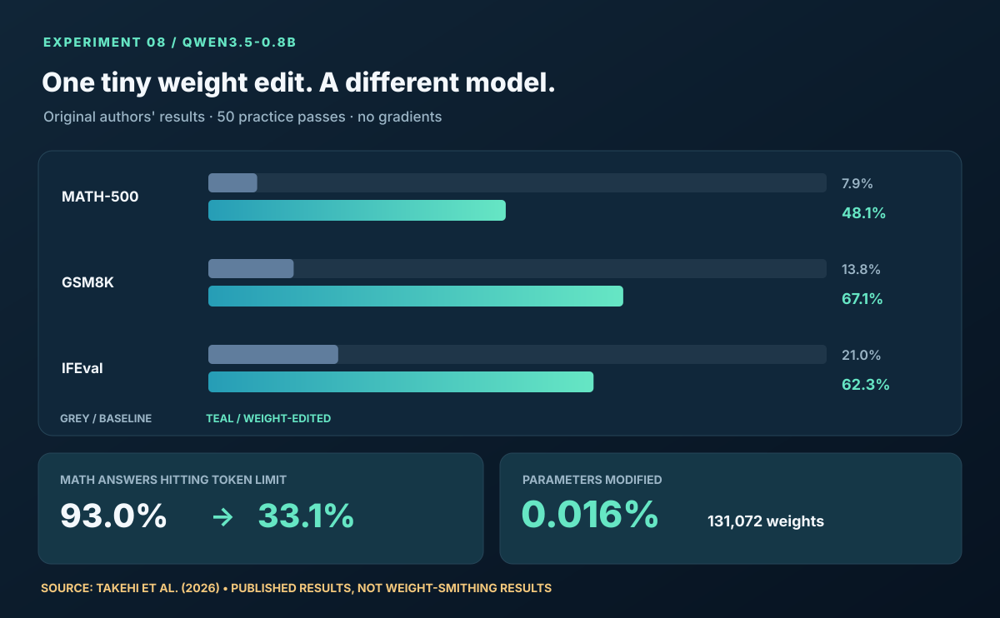
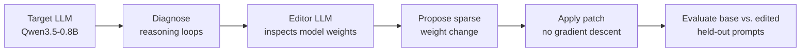

<div align="center">
  

  <strong>Weight Smithing</strong> — exploring whether language models can understand and directly rewrite the parameters of other language models.
</div>

# Weight Smithing

**Can one LLM debug another LLM by changing its neural weights, without gradient descent?**

Usually we improve a language model by changing prompts, collecting fine-tuning data, or running an optimizer. [*Weight-space programming*](https://rikiyat.github.io/blog/weight-space-programming/) suggests a different possibility: a frontier LLM identifies what is going wrong inside a model, then **edits the weights themselves**.

Our new reproduction target is **Experiment 8**, in which GPT-6 Astra inspected the weights of [Qwen3.5-0.8B](https://huggingface.co/Qwen/Qwen3.5-0.8B), diagnosed a repetitive-reasoning failure, and altered a tiny part of its MLP weights.

> [!IMPORTANT]
> **Project status:** This is our **next reproduction target**, not an achieved result. We have **not** yet run Qwen, generated an LLM-directed patch, or reproduced Experiment 8. The charts immediately below show **numbers reported by the original paper**, not our measurements. Our completed work so far is an independent, hand-programmed toy Breakout proof of concept, preserved [here](docs/breakout.md).

## The result we're trying to reproduce



The authors report these results after Astra used **50 practice forward passes** to diagnose and edit Qwen. Evaluations used the same sampling settings before and after editing.

| Published metric | Original Qwen | After Astra's edit |
|---|---:|---:|
| MATH-500 accuracy | 7.9% | **48.1%** |
| GSM8K accuracy | 13.8% | **67.1%** |
| IFEval instruction following | 21.0% | **62.3%** |
| MATH-500 answers hitting 32,768-token limit | 93.0% | **33.1%** |
| Parameters modified | — | **131,072 (~0.016%)** |

**Source:** [Takehi et al., *Sparks of Weight-Space Programming*, Experiment 8](https://rikiyat.github.io/blog/weight-space-programming/) · [Original authors' complete experiment logs](https://github.com/RikiyaT/lm_understand-logs).

### What was actually fixed?

The base model often got trapped in repeated reasoning, continuing until its token budget ran out. Astra used practice prompts and forward passes to investigate this failure, then subtracted a harmful direction from **64 output columns in each of two MLPs (layers 15 and 19)**, affecting 131,072 parameters. It did **not** use backpropagation or fine-tune the model.

This is more precise than saying the edit *taught Qwen mathematics*: the reported mechanism removed an obstacle to completing answers the model could already reason through. In a separate test on Gemma 3 270M, a model without the same looping issue, the authors did **not** establish a comparable improvement.

## How the experiment works



The distinction matters: **the editor reasons about model internals and changes parameters directly**, rather than merely proposing better prompts or launching a standard training job.

## What this repository will test

The goal is not to copy the published before/after numbers onto our own leaderboard. It is to reproduce the mechanism under a transparent and falsifiable protocol:

1. **Baseline:** Pin the exact open-weight Qwen checkpoint and evaluation settings. Record sample completions, repetition behavior, answer accuracy, and output token counts.
2. **Recreate the patch:** Inspect the [original released logs](https://github.com/RikiyaT/lm_understand-logs), isolate the documented edit, and independently apply and measure it.
3. **LLM-as-editor:** Have an LLM inspect the target's weights, diagnostics, and *practice-only* generations. Save its proposed parameter patch **before** held-out evaluation; do not use gradients.
4. **Controls:** Compare original model, author-inspired patch, editor-proposed patch, and matched-size random or shuffled edits. Include unrelated behavior and regression tests.
5. **Make it visible:** Publish real before/after completions, repetition-rate plots, benchmark accuracy, edit sparsity, and reproducibility details.

See the [Experiment 8 reproduction protocol](docs/experiment8-plan.md) for the controls, limitations, and exact paper settings. All paper-reported numbers are separately captured in [results/paper-experiment8.json](results/paper-experiment8.json).

## What is already implemented?

**Phase 0 — direct-weight programming in a small network.**

We built an independent 600 → 32 → 32 → 6 tanh controller whose parameters are written without gradient descent. It plays a **simplified toy version of Breakout** using hand-coded position/velocity circuits, not an LLM-generated patch. Across 2,000 toy episodes, it averaged **8.02 reward** versus **1.58** for a zero-weight randomized baseline, with just **318 nonzero parameters**.

That experiment is useful as a minimal demonstration of direct parameter editing, but **it does not test whether an LLM can edit another LLM**.

[Breakout experiment, original charts, and full reproduction commands](docs/breakout.md)

## Get started

The existing **toy Breakout** code is runnable today:

```bash
git clone https://github.com/KevinmKrieg/weight-smithing.git
cd weight-smithing
python -m pip install -e '.[dev]'
pytest -q
python -m weightspace.evaluate --backend toy --episodes 300
```

**There is no Qwen reproduction command yet**, because no Qwen edit or matched benchmark has been implemented. The full Experiment 8 workflow is a research plan, not an executable feature. This will be updated as each phase is actually verified.

## Roadmap

| Milestone | Status |
|---|---|
| Direct edits to a small neural network | **Implemented** |
| Toy Breakout results and robustness plots | **Implemented** |
| Qwen Experiment 8 paper analysis + provenance | **Documented** |
| Run base Qwen and diagnose loops locally | Not started |
| Independently recreate the authors' Qwen patch | Not started |
| Generate a new patch with an LLM editor | Not started |
| Evaluate against held-out sets and proper controls | Not started |

[Detailed roadmap](docs/reproduction-roadmap.md) · [Paper](https://rikiyat.github.io/blog/weight-space-programming/) · [Source logs](https://github.com/RikiyaT/lm_understand-logs)

---

<sub>Independent research reproduction inspired by Takehi, Teoh, Zhang, and Khattab (2026). Not affiliated with the paper's authors. Published benchmark results are attributed and explicitly distinguished from our own experiments. Code: MIT.</sub>
