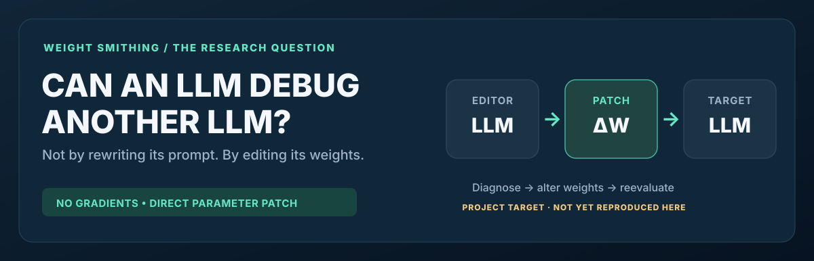
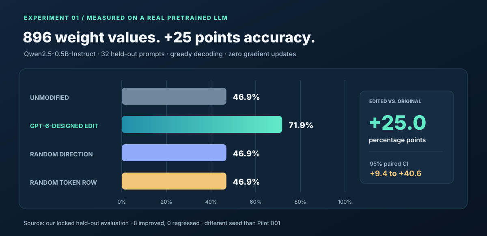
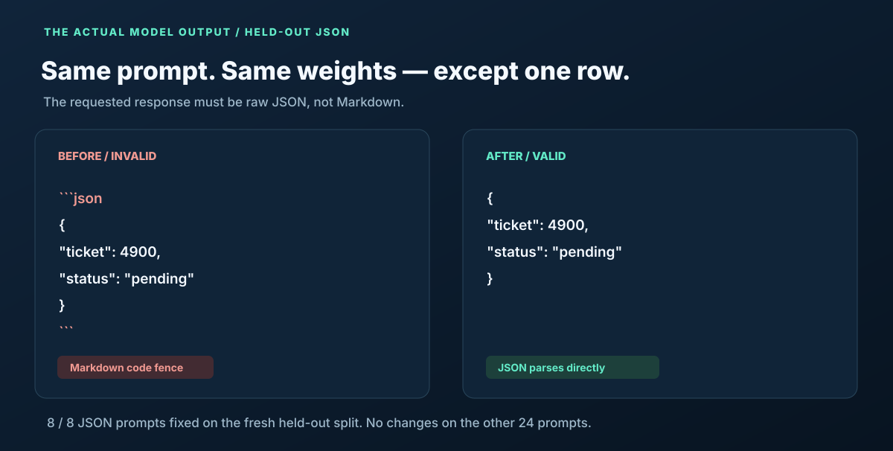
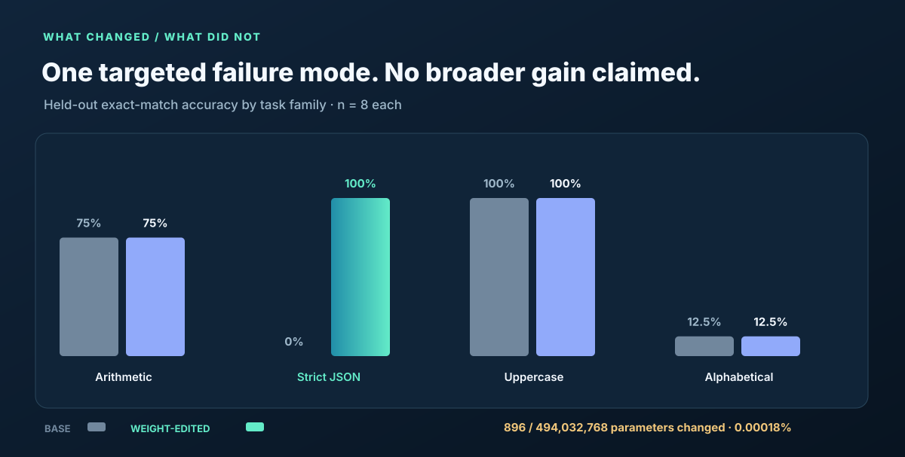

  

# Weight Smithing

**Can an LLM improve a different, pretrained language model by directly modifying its neural weights—with no gradient descent?**

We tried it on [Qwen2.5-0.5B-Instruct](https://huggingface.co/Qwen/Qwen2.5-0.5B-Instruct), using our own held-out instruction-following benchmark. A GPT-6-designed intervention changed a single output-weight row, fixing a specific JSON-formatting failure without fine-tuning or an inference-time token blacklist.

This is **our measured experiment**, not a reproduction of another paper's benchmark numbers.

## The result

| Fresh held-out benchmark | Original Qwen | Edited Qwen |
|:--|--:|--:|
| **Overall accuracy (32 prompts)** | 46.9% (15/32) | **71.9% (23/32)** |
| Exact JSON (8 prompts) | 0% | **100%** |
| Arithmetic (8 prompts) | 75% | 75% |
| Uppercase-only response (8 prompts) | 100% | 100% |
| Alphabetical selection (8 prompts) | 12.5% | 12.5% |

**+25.0 percentage points**, paired 95% bootstrap CI **[+9.38, +40.62]**. Eight held-out answers improved; none regressed. Both norm-matched controls—altering the same output row in a random direction or the same direction in a random token row—remained at **46.9%**.

Only **896 of 494,032,768 parameters** changed: approximately **0.00018% of Qwen's weights**.

[Full measured results, model revision and source links](results/qwen-output-row-pilot-002.json) · [Raw generations and saved edit vector](https://github.com/KevinmKrieg/weight-smithing/actions/runs/41532760652/artifacts/13181044922) · [Successful GitHub Actions run](https://github.com/KevinmKrieg/weight-smithing/actions/runs/41532760652)

## What actually changed?

The unmodified model kept returning valid JSON **inside Markdown code fences**, even when instructed to return raw JSON. GPT-6 identified that practice-set failure mode and proposed directly changing the output-weight row responsible for the code-fence token.

Our program took the model's final hidden representations on **practice failures only**, computed a small vector aligned with those states, and subtracted it from the code-fence token's output-projection weights. The targeted token's average practice-prompt logit was lowered by a fixed, precommitted margin of 6.0. Then the edited model generated normally under exactly the same decoding settings as the unmodified model.

- **Editor:** GPT-6 designed the intervention in ChatGPT after reading practice-only model diagnostics. It did **not** individually generate all 896 numerical edits or use an autonomous editor API for this trial.
- **Target:** Pretrained Qwen2.5-0.5B-Instruct, pinned to revision 7ae557604adf67be50417f59c2c2f167def9a775.
- **Actual edit:** A single 896-weight LM-head row (token ID 73594, the Markdown code-fence token); L2 magnitude approximately 0.0217.
- **Optimization:** Zero gradients, optimizer steps, LoRA updates, fine-tuning examples or loss-minimization steps.
- **Evaluation:** Greedy decoding on 32 independently generated held-out tasks, using a fresh seed not used for the preceding failed experiment.

**Interpretation:** This is a real, narrow output-formatting repair, **not** evidence that the model learned new mathematics or improved general intelligence. It is also more constrained than unrestricted LLM authoring of an arbitrary weight patch. Additional out-of-domain benchmarks and seeds are required before making wider claims.

[Detailed experiment, validity limitations and exact reproduction settings](docs/qwen-output-edit.md)

## We also recorded what did *not* work

Our initial attempt used GPT-6 to select **six internal MLP columns** from practice activation statistics, editing 5,376 weights. On a separate 32-prompt held-out set, all four model variants—including the edited version, an activation-ranked baseline and a random control—scored **37.5%**, producing identical responses.

We preserved this negative result rather than replacing it with the successful trial: [Pilot 001 details](docs/qwen-pilots.md) · [Full source run](https://github.com/KevinmKrieg/weight-smithing/actions/runs/41531166416).

## Reproduce the weight edit

Python 3.10+ and sufficient memory for a ~0.5B-parameter model:

~~~bash
git clone https://github.com/KevinmKrieg/weight-smithing.git
cd weight-smithing
python -m pip install -e '.[target,dev]'
pytest -q

python -m weightsmith.targeted \
  --revision 7ae557604adf67be50417f59c2c2f167def9a775 \
  --seed 41 --heldout-seed 7802 \
  --practice-per-family 2 --heldout-per-family 8 \
  --regression-per-family 3 --max-new-tokens 32 \
  --logit-margin 6.0 \
  --out artifacts/qwen-output-edit-001
~~~

This command downloads the target checkpoint, computes the intervention using practice prompts, locks the patch **before** any held-out scoring, and compares base, edited and both controls. No editor API key is required to replay this fixed GPT-6-designed strategy.

For an **API-driven editor LLM** that chooses sparse internal MLP columns from new practice diagnostics, see [the broader experiment harness](docs/research-protocol.md). That path is available, but its first recorded attempt had **no improvement**.

The project also retains our earlier [small-network Breakout demonstration](docs/breakout.md) as supporting background.

## Next research steps

- Scale beyond 32 held-out prompts and validate with multiple different seeds.
- Measure regressions on tasks where Markdown fences are *required* or useful.
- Test a second small open LLM and a more substantial failure mode.
- Allow an editor LLM to propose less-constrained numerical changes without gradient feedback.

---

Independent MIT-licensed project inspired by weight-space programming. Published numbers here are from our own project experiments, with raw results and provenance linked. Not affiliated with the source paper's authors or Qwen developers.
