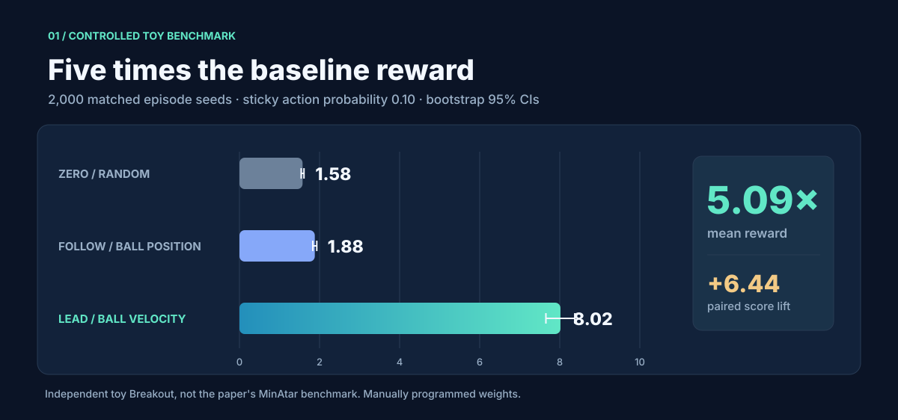
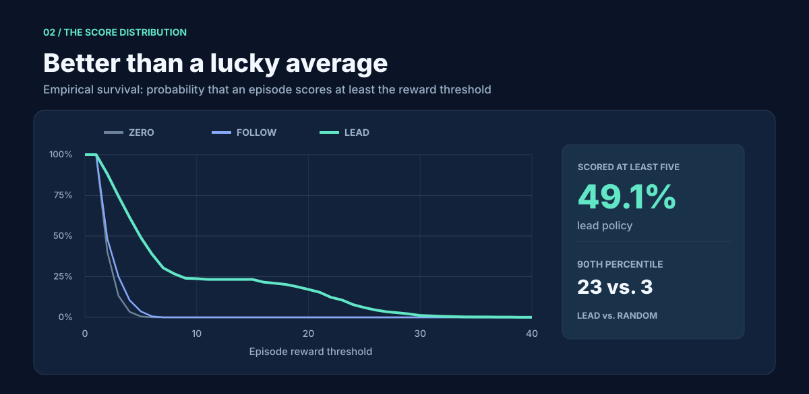
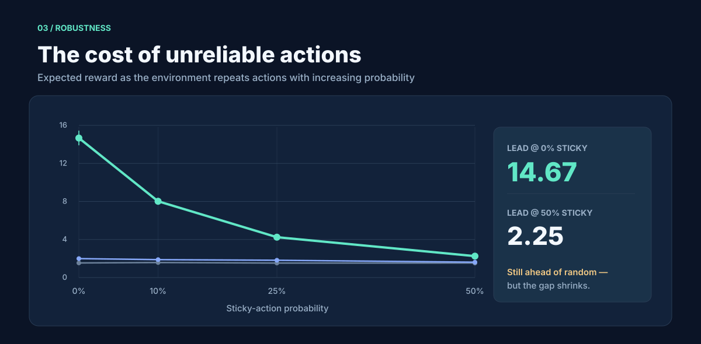
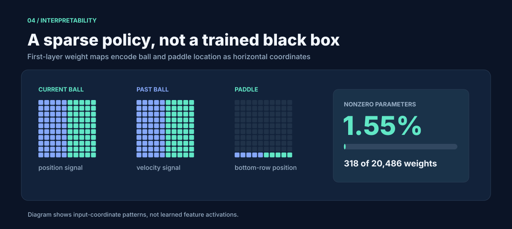

> **Archived README.** This used to be the repository front page. The [main README](../README.md) now focuses on Experiment 8: one LLM editing another language model. The experiments below remain runnable and their results are from an **independent toy Breakout**, not the original paper.

# Supporting experiment: Direct-weight Breakout

**Can a neural network be programmed directly by changing a tiny fraction of its weights, without training?**

This is an independent, auditable **partial reproduction** of [Sparks of Weight-Space Programming](https://rikiyat.github.io/blog/weight-space-programming/) by Takehi, Teoh, Zhang, and Khattab (2026). The project implements a **600 → 32 → 32 → 6 tanh** controller, with a sparse weight-editing program and reproducible Breakout experiments.

> [!IMPORTANT]
> **These results are from our own simplified toy Breakout, with hand-designed weights.** They do **not** reproduce the paper's MinAtar performance, compare against PPO, or demonstrate an LLM writing the weights. This repository currently reproduces the *method*, not the headline paper benchmarks.

## At a glance

| Metric · 2,000 toy episodes | Result |
|:--|--:|
| Position + velocity controller (lead) | **8.02 reward** |
| Zero-weight randomized baseline | **1.58 reward** |
| Reward multiplier | **5.09×** |
| Matched-seed reward improvement (95% CI) | **+6.44 [6.07, 6.80]** |
| Paired episode win rate | **80.1%** |
| Nonzero parameters in lead controller | **318 / 20,486 (1.55%)** |

All three policies use the same network shape. Results: seeds 0–1999, 500-step cap, 10% sticky actions and action sampling at temperature 1. Confidence intervals use 5,000 seeded-episode bootstrap resamples.

A small, transparent circuit is enough to outperform a uniform random policy in this simplified environment. The difference is much larger when the controller also estimates horizontal ball velocity.

## Beyond the average

The lead controller scores **at least five reward in 49.2%** of episodes, compared with **0.6%** for random. Its 90th-percentile episode reward is **23**, versus **3** for the baseline. The curves are empirical episode distributions, not fitted models.

## Stress test: sticky actions

| Chance the last action repeats | Episodes per policy | Zero | Follow | Lead |
|:--|--:|--:|--:|--:|
| 0% | 1,000 | 1.53 | 1.99 | **14.67** |
| 10% | 2,000 | 1.58 | 1.88 | **8.02** |
| 25% | 1,000 | 1.52 | 1.82 | **4.24** |
| 50% | 1,000 | 1.53 | 1.62 | **2.25** |

The same weights are evaluated across all conditions; no retraining or parameter adjustment occurs. The steep decline is an important limitation of the heuristic controller.

## Inside the sparse circuit

The first hidden layer is programmed to represent **ball X minus paddle X** and, in the lead variant, **ball X minus previous ball X**. A second tanh layer combines the signals and the output weights favor left, right, or no-op. Every parameter starts at zero; only **318** need become nonzero.

There is no gradient computation, data fitting, optimizer, or training loop in [the weight writer](../src/weightspace/program.py).

## Reproduce it

Python 3.10+:

~~~bash
git clone https://github.com/KevinmKrieg/weight-smithing.git
cd weight-smithing
python -m pip install -e '.[dev]'
pytest -q

# Repeat the main experiment
python -m weightspace.evaluate --backend toy --episodes 2000 \
  --sticky 0.1 --max-steps 500 --out artifacts/toy-2000.json

# Run all four robustness settings and regenerate the statistical report
python scripts/run_benchmarks.py

# Rebuild the five SVGs shown on this page (Node.js 18+)
node scripts/render_readme_charts.mjs
~~~

The [benchmark summary](../results/benchmark-summary.json) provides the data behind every chart and exact confidence intervals.

For a **separately labeled, optional upstream MinAtar evaluation** (not equivalent to the paper's custom six-channel mapping):

~~~bash
python -m pip install -e '.[minatar]'
python -m weightspace.evaluate --backend minatar --episodes 100 --max-steps 1000
~~~

For weight exports and a prompt to ask an LLM to interpret a policy, run:

~~~bash
python -m weightspace.inspect --policy lead --export artifacts/lead.npz \
  --prompt artifacts/lead-prompt.txt
~~~

A [safe JSON-only sparse edit proposal interface](../docs/llm-proposal-prompt.md) is included for future **one-shot LLM weight-writing trials**; it does not execute generated code.

## Reproduction status

| Milestone | Status |
|---|---|
| Exact network dimensions and direct zero-shot weight edits | Complete |
| 2,000-episode toy benchmark and bootstrap confidence intervals | Complete |
| Sticky-action robustness sweep | Complete |
| Reproducible SVG dashboard | Complete |
| Official MinAtar experiment | Not run |
| Fair, same-environment PPO baseline | Not run |
| Actual LLM-generated network weights | Not run |
| Published Seaquest / Asterix scores | Not reproduced |

[Research roadmap and validity notes](../docs/reproduction-roadmap.md)

---

Independently implemented, MIT licensed. Inspired by Takehi et al.; not affiliated with the authors. The upstream MinAtar dependency has its own license.
